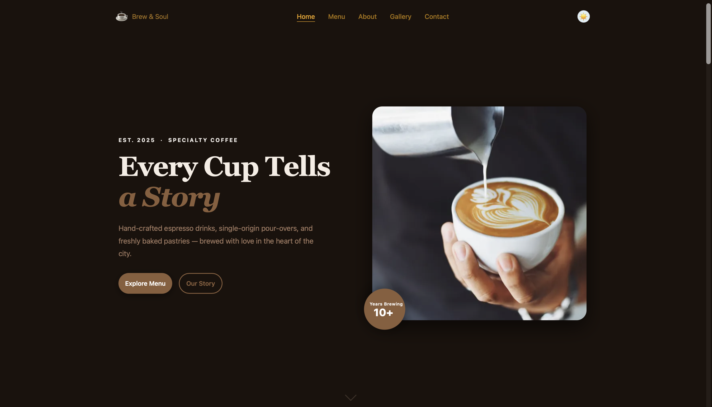

# Brew & Soul - Coffee Shop Website

A responsive coffee shop website built with pure HTML, CSS and JavaScript.

**Live demo:** https://coffee-shop-five-ochre.vercel.app

## Features

- Responsive layout (desktop, tablet, mobile)
- Light / dark mode (saved in localStorage)
- Menu filter tabs and poster-style menu cards
- Testimonial carousel with auto-play
- Gallery with lightbox
- Contact form with client-side validation
- Scroll reveal animations and animated counters

## Project Structure

    Coffee_Shop/
    |-- index.html
    |-- pages/    (menu, about, gallery, contact)
    |-- css/
    |-- js/
    `-- images/

## Run Locally

    python3 -m http.server 5500

Then open http://127.0.0.1:5500

## Author

Sam Channa
